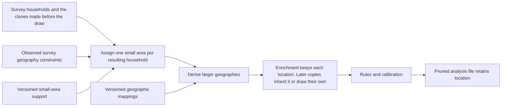

# Geography assignment in the population graph

Design decision, corrected 10 September 2026: finish constructing the full survey
multispine, including its initial support and PUF clones, then assign one small
census area to each resulting household. Derive larger geographies from that
area using identified, versioned mappings. Distinct clones may receive different
areas subject to their observed source constraints. The assigned location then
remains fixed through subsequent enrichment, calibration and analysis views.

Amended for the UK on 4 November 2026 (microcosm#931): for the UK, assignment
comes before enrichment. Once the spine's source stages have run, every FRS
household gets K geographic clones, and each clone draws one small census area
within its FRS region. The draw keeps to the address's deprivation (IMD)
decile and samples areas by their households in the household's council-tax
band. Where an input is missing or its cell is empty, the draw falls back,
level by level, to the region alone. Every later stage runs on the clones and
sees each clone's area. The SPI support channel's copies and its income band
donors draw an area of their own in `spi_copy_areas`, once both stages have
made them. Every later copy keeps its parent's area. Each household's area then
stays fixed through enrichment, calibration and export. The dense line builds
on a spine of K clones and the national line on a spine of one, and both ship
the areas (María's rulings of 4 and 6 November 2026). For the UK this order
replaces the one above. [The UK spine](#the-uk-spine) gives its stages.

> These US passages describe the work of PolicyEngine/microcosm#893, which
> closed unmerged on 9 October 2026. Its modules, graphs and receipts never
> reached main.

The earlier block-before-clone implementation and its passing controls remain
historical evidence. They do not demonstrate this corrected ordering. Geographic
assignment must use a stable post-clone identity, including a clone discriminator
where original-source identity alone is shared by multiple households.

The corrected order now passes 70 controls on invented inputs, plus a separate
default-path compatibility check. The nine-node survey prefix expands the initial
clones before assignment; its nineteen-node financial and twelve-node age
extensions retain the assigned geography. Draw identity combines
`survey_geography_origin_key` with `household_support_clone_index`, so renumbering
households does not redraw their location. A typed validation artifact orders
financial enrichment after the geography gate. See the
[scoped acceptance](../experiments/us-postclone-geography-70-controls-20260910.json).
Native execution of this corrected order and population-quality acceptance
remain pending. The older results below retain their original source scope.

## Declarative country capability

Geography is a declarative country capability backed by shared graph operators.
A country declares its atomic area type, code system and vintage, source mapping
artifacts, observed constraints and sampling-weight convention. An observed
constraint can be a place, such as the FRS region, or a recorded attribute of
the address, such as its deprivation decile. The weight can be chosen per
household (`weight_by`), and a draw whose constraint cells can be empty declares
a fallback ladder. The UK declaration can select an area system by nation.
Adding a country should not require writing a country-specific assignment or
derivation kernel.

The shared assignment operator selects the atomic area using the declared
support and stable household identity. Shared lookup/join operations derive
larger geographies from identified mappings. If an input already has a qualified
atomic area, validate and retain it. Source acquisition and normalization may
still require publisher-specific adapters; they produce the common support and
mapping contracts, rather than owning a separate assignment algorithm.

Sampling and derivation remain executable graph operations with typed inputs,
outputs and replay identity. A country configuration does not itself execute
them. Mapping edges retain their relation type, including exact nesting or an
explicit best-fit convention. Prefer existing graph lookup/join primitives where
they support these contracts; introduce only the shared behavior they lack.

The existing country-spec geography declaration is a starting point, but its
legacy clone-and-assign contract and country-specific runtime references do not
yet implement this shared atomic-area contract. Preserve those compatibility
paths while the shared operators and country adapters receive their own checks.
The UK full build no longer keeps the legacy ladder draw (microcosm#931): the
spine declares its area stages in `uk/spec/sources.yaml`, and
`uk/spec/geography.yaml` still attests the ladder draw, at `phase: legacy`.

## Country anchors

| Country | Assigned household anchor | Derived geographies |
| --- | --- | --- |
| US | Census block, with census vintage | Block group, tract, county, state, PUMA and congressional district using the declared mapping/boundary vintages |
| England and Wales | 2021 Output Area | LSOA, MSOA, local authority, ward, constituency and region |
| Scotland | 2022 Output Area | Scottish statistical areas, council area, ward, constituency and region |
| Northern Ireland | 2021 Data Zone | Super Data Zone, local government district, constituency and nation |

Northern Ireland's 2021 Data Zones replaced the 2011 Small Areas. Scottish
Output Areas use the 2022 census. These are different source systems; the graph
must retain the original area type and vintage rather than imply identical units.
See [NISRA census output geography](https://www.nisra.gov.uk/statistics/census-2021-results/census-output-geography)
and [Scotland's census general report](https://www.scotlandscensus.gov.uk/about/scotlands-census-2022-general-report/).

Some larger boundaries do not nest exactly. England and Wales small-area estimates
use best-fit mappings for wards and parliamentary constituencies. The derived
edge must identify whether its mapping is exact, best-fit or another explicit
approximation, with its source and vintage. A mapping convention cannot be
presented as observed household location. See the
[ONS methodology](https://www.ons.gov.uk/peoplepopulationandcommunity/populationandmigration/populationestimates/methodologies/smallareapopulationestimatesqmi).

For US congressional districts, the Census Bureau's CD119 block equivalency
file assigns whole original 2020 tabulation blocks to districts. Colorado's
block `080010096072000` crosses the enacted CD07/CD08 boundary but is assigned
to CD08 for tabulation. Represent this as an official tabulation mapping,
not exact spatial containment. The same source distinguishes original 2020
blocks from subsequently adjusted geometry and includes undefined `ZZ` areas.
See the [Census Bureau's CD119 documentation](https://www.census.gov/geographies/mapping-files/2025/dec/rdo/119-congressional-district-bef.html).
By contrast, the same-vintage tract-to-PUMA relation is nested, as described in
the [Census PUMA guidance](https://www.census.gov/programs-surveys/geography/guidance/geo-areas/pumas.html).

## Required behavior

- Respect observed source constraints, such as ACS PUMA, FRS region and the FRS
  IMD decile. A recorded attribute of the address that is not a place, such as
  the FRS council-tax band, may weight the draw instead. Record inferred
  geographic detail as modeled. Preserve observed source geography separately
  from the assigned location.
- Bind each draw to a stable household identity, seed and assignment definition.
  Reordering rows or selecting an existing household must not redraw its location.
  Changed source support or boundary mappings produce a new identified revision.
- Assign household members consistently with their resulting household. Initial
  clones have distinct draw identities and may receive different anchors.
  Materialized county, district and other fields must agree with that household's
  selected anchor. Source geography remains a separate observed constraint.
  In the UK, Northern Ireland's BRMA is not read off its area: with no open BRMA
  geography, the spine draws it from census counts, as the retired `frs_brma`
  stage did.
- Show assignment and derivation as separate operations: as graph nodes, or as
  declared parts of one stage. The UK spine's `atomic_area_assign` declares its
  constraints, weight rule, fallback ladder and derived layers in one operation,
  and a gate of its own checks the derived mappings
  (`uk_atomic_area_mapping_integrity`). Expose the source constraints, support,
  sampling weights, mapping conventions and judgment annotations in the
  inspector.
- Refuse missing, ambiguous or incompatible mappings unless an explicit,
  source-supported resolution rule is part of the assignment definition.
- Verify inheritance and mapping consistency again on every pruned export.
  Engine input profiles and geographic build invariants are separate contracts.

## Existing implementation and next changes

The shared implementation now lives in `microcosm.build.atomic_geography` and
`microcosm.build.graph_atomic_geography`. It provides four country-neutral nodes:
`geography.support_import@1`, `geography.assign_atomic@1`,
`geography.derive@1` and `geography.gate@1`. Countries supply declarations and
normalized, pinned support files. The graph interfaces and legacy country
operators are unchanged. Country configuration and native support integration
remain necessary before these nodes can assign locations in a release build.

The UK spine does not compose these nodes. Its `atomic_area_assign` and
`spi_copy_areas` stages call the operator's assignment, derivation and
validation in process, and the UK's release lines take their areas from the
spine (microcosm#931). The same work added country-neutral pieces beside the
operator:

- `microcosm.build.clone_expansion` makes K clones of every record, each at an
  equal share of its weight.
- `atomic_support_conditioning.choose_fallback_levels` gives each household the
  first level of a declared fallback ladder whose cell has mass.
- `atomic_support_expectations.draw_cell_expectations` gives a draw cell's exact
  expected value under the draw's own weights.
- `copy_agreement` checks that copies still equal their parents on declared
  columns.

The support contract uses deterministic NPZ bytes with no object arrays. It has
one unique string code per atomic area; every mapping column identifies its
source, vintage and relation, and every integer sampling-weight column identifies
its source and basis. Nonnegative weights have a bounded exact total. A source
adapter must resolve any nonfunctional crosswalk before admission; the shared
lookup never multiplies households through a many-to-many join.

Assignment conditions on all nonmissing observed constraints jointly. Declared
stages can use different weights—for example, household counts to select a
constituency followed by population counts to select its small area. Each draw
uses the existing `keyed_uniform` protocol with stable source identity, the
declared stream, system, stage, assignment definition and support digest.
Selection uses an integer inverse CDF. Reordering, subsetting or adding unrelated
households preserves draws. The numerical declaration remains `platform_bitwise`;
cross-platform equivalence has not been established.

The version-1 declaration lists `identity`, `stream`, three assignment `outputs`
(`area`, `system`, `basis`), and `systems`. Each system supplies its atomic
identity and source, a selector, observed constraints, an optional observed-area
column, sampling stages and derived layers. A stage samples by one `weight`
column, or declares `weight_by` (`input`, `map`, `default`) instead: each
household samples by the weight column `map` names for its `input` code, or by
`default` where the code is missing, and a code `map` does not name is refused
(microcosm#931). A declaration without `weight_by` keeps its canonical bytes,
so its definition digest and draws are unchanged. Geographic codes use nullable
strings throughout, retaining leading zeroes. An engine that needs integer
storage must declare that conversion separately. A system without a particular
layer produces missing values for that layer, which the integrity gate checks.
The graph stores the canonical declaration in its normative `definition`
parameter and exposes the stream separately; no graph parameter grammar changed.

The 34 invented-data controls include real graph execution, cold and warm reuse,
source-change invalidation, exact lookup metadata, independent sampling-boundary
checks, three-system routing, observed-area retention, row/subset stability and
clone/prune validation. All passed under the isolated control runner on
9 September 2026. These checks establish shared operator behavior; they do not
admit a Census/ONS source or certify any population's geographic fit. The gate
checks mapping integrity, while the executor and build own structural lineage
and population-quality acceptance. The country's chosen identity still needs
verification across actual sampling rungs.

> These US passages describe the work of PolicyEngine/microcosm#893, which
> closed unmerged on 9 October 2026. Its modules, graphs and receipts never
> reached main.

The US development composed graph attaches geography after harmonization, but
`us_runtime/graph_geography.py` selects a joint tract/congressional-district cell
and emits PUMA, county and district. It does not assign a Census block. Its prior
national source and joint-support checks therefore do not establish block-first
acceptance. The separate atomic survey graph now provides that block assignment
and derivation connection before enrichment. Its population-only national block
support and source review are recorded below.

### The UK spine

The UK spine assigns geography (microcosm#931). It draws on three atomic-area
supports: England and Wales 2021 Output Areas, Scotland 2022 Output Areas and
Northern Ireland 2021 Data Zones. They are rebuilt from published ONS, NRS and
NISRA lookups and pinned in `uk/spec/sources.yaml` and
`uk/uk_atomic_area_supports.provenance.json`. Every mapping column carries its
publisher relation (`exact`, `best_fit`, `official_tabulation`) and vintage.
The draw reads their conditioned forms (below). These spine stages run in this
order:

1. The source stages, from `frs_spine` to `frs_annual_income_spells`, run on
   the survey households, before any clone exists. `frs_spine` writes two
   inputs of the draw. `imd_decile` is the address's IMD decile within its own
   nation, or 0 where the survey gives none. `council_tax_band_observed` says
   whether the household's council-tax band is one the survey gives and its
   region uses.
2. `geographic_expand` gives every FRS household K geographic clones, each with
   an equal share of its design weight. The spine build's `--n-clones` sets K,
   one by default. A dense release builds on the local doctrine's K, 15, and the
   national line on one clone.
3. `geographic_identity` keys each clone. Its `geography_household_key` is
   `household_draw_key` over the FRS source, the household's FRS vintage, its
   true source and its clone path, read from the lineage columns, never from
   ids, weights or values.
4. `atomic_area_assign` draws one atomic area for each clone with the shared
   operator, and derives the ladder columns from the support's mappings. Every
   level of the draw keeps the household's FRS region. A household takes the
   first level whose inputs it has and whose cell has mass in the weight it
   samples by:
   - L0: its decile, sampling areas by their households in its band;
   - L1: its decile, sampling by all households;
   - L2: no decile, sampling by households in its band;
   - L3: no decile, sampling by all households.

   Northern Ireland, which has domestic rates, samples by all households, at L1
   or L3. The draw reads the band and never changes it.
5. `local_authority` resolves the engine's `local_authority` from the drawn
   authority code, fail-closed. `rfdr` sets `in_rural_fuel_duty_relief_area`
   from the drawn output area.
6. `frs_take_up`, `frs_person_draws` and `frs_household_draws` run on every
   clone. `area_brma`, in the place `frs_brma` held, reads each Great Britain
   household's BRMA off its drawn area through the area-to-BRMA layer. Northern
   Ireland has no open BRMA geography, so its households draw a BRMA from census
   counts, as `frs_brma` did.
7. `spi_support_channel` and `spi_income_band_donors` copy FRS households whose
   incomes the SPI income stage then draws from SPI taxpayers' records.
   `spi_copy_areas` gives each such copy a key over its own copy path and an
   area of its own. The area is drawn within the copy's region by all
   households (L3), not by its parent's decile or band (María's ruling of
   6 November 2026). The stage then sets the copy's local authority, BRMA and
   rural fuel duty relief flag as the stages above do. Northern Ireland's
   copies draw their BRMA from census counts on their own benefit units
   (María's ruling of 11 November 2026).
8. Later stages price or place by area:
   - `spi_housing_shell` prices the Great Britain copies' council tax by the
     2024-25 statute at their region's expected Band D, for the band the shell
     draws for them.
   - `private_rent` reads each Great Britain private rent off its BRMA's list of
     rents, at its rank among the FRS private rents of its region and size.
   - `council_tax_localise`, just before the WAS chain, takes each Great Britain
     household's council tax to its drawn local authority (María's rulings of
     6, 13 and 14 November 2026).
   - In `was_wealth`, each England and Wales owner with a positive drawn main
     residence reads its value off its constituency's sale-price distribution,
     at a keyed point inside its weighted slice of that constituency and its
     geographic clone, and the chain's later wealth draws condition on it
     (María's rulings of 6 and 17 November 2026).
9. Copies made after `spi_copy_areas`, by `high_value_home_support`,
   `cgt_support_split`, `cgt_incidence_clone` and `cgt_residential_split`, keep
   their parent's key, area, ladder, local authority, BRMA, rural fuel duty
   relief flag, council tax and rebate.

A clone's draw keys on its geography key, on the stage's own stream
(`uk-spine-atomic-area-v1`, seed 0), and its level depends only on its own
inputs and the support. So its area does not depend on row order, on the
sample or on any other household, and clone k draws the same area at every K
above k. The engine reads each clone's local authority, BRMA and rural fuel
duty relief flag. The decile and the band flag are not engine inputs, so the
release boundary drops both.

The dense and national lines draw no areas of their own. Each builds only on a
spine whose stages assign areas (`uk_runtime.spine_posture`), and takes that
spine's clones and areas as they stand. The ladder in
`uk_runtime/geography_ladder.py` no longer draws areas in the full build:
`--geography-assignment` and its legacy mode retired with the dense line's own
expansion, identity and geography nodes. The dense role still reads the ladder
(`--ladder`) for the rosters and dispersion checks that target compilation
uses.

The national line builds on a spine of one geographic clone whose households
carry their areas (María's rulings of 4 and 6 November 2026). Its release drops
the clone indices, which are constant at one clone, and ships the three area
codes under the consumers' names, as the dense release does.
[UK full-build graph](uk-full-build-graph.md) describes the national role.

Copy ids do not depend on K (María's ruling of 7 November 2026). Each UK copy
layer owns a fixed decimal field of the id (`uk_runtime.copy_id_table`). Copy k
of a row takes the row's id plus k times its layer's radix, on all five id
columns. Clone 0 keeps the survey's ids, and every copy id depends only on its
source id and its copy path. Draws keyed on a row's own id or key, and counts
taken within each clone, give clone 0 what the one-clone spine draws. Through
`area_brma` only `frs_person_draws`' apprentice walk reads summed weights, and
a near-tie of those sums can move clone 0 at a K that is not a power of two.
The tests hold clone 0 to the one-clone spine on their invented frames. Clone
0's SPI copies take the same keys and areas at every K, for the copies both
spines make. Later stages that fit, rank, rake or scale over the whole frame
pool the clones, so their outputs nest only approximately.
[UK household identity after cloning](uk-atomic-household-lineage.md#ids)
gives the id fields.

FRS-trained fits see each survey record once (María's ruling of 6 November
2026). A fit folds a record's geographic clones into one training row, at their
summed weight, where the clones agree on what the fit reads. Clones that differ,
through an area or a draw of their own, stay rows of their own, each variant at
the summed weight of the clones that share it. Other copies are not folded.
Receipt counts and their floors count a household's clones and copies once, as
one source household.
[UK household identity after cloning](uk-atomic-household-lineage.md#shared-lineage-readers)
lists the readers and the fits that fold.

The spine checks its areas at its gate boundaries. At the assembled boundary,
`uk_atomic_area_mapping_integrity` checks the base draw's derived mappings. At
the transferred boundary, gates check the copies' draw, each copy's agreement
with its parent and the engine's area domains.
[UK full-build graph](uk-full-build-graph.md) describes the build's gates.

Two pieces are later work (microcosm#931). Area predictors for the
donor-survey stages, such as an area classification, come one stage at a time.
Seating the SPI copies by area would weight their area draw by area incomes,
and any tilt of their drawn band toward the area's band mix waits for it
(María's ruling of 14 November 2026). Today the copies draw within their region
by households alone.

Each support also has a conditioned form, which the spine's area draw reads
(microcosm#931). It is declared in
`uk/spec/sources.yaml` with role `uk_atomic_area_conditioned_support`, beside
the support it extends, and recorded in
`uk/uk_atomic_area_conditioned_supports.provenance.json`;
`tools/build_uk_conditioned_area_supports.py` builds it from the registered
support's bytes, chronicle#412's raw-only registrations and, from the pinned UK
Chronicle feed, NRS's dwellings by band and 2022 data zone (chronicle#421). It
adds two kinds of column:

- **`imd_decile`**, an exact-match constraint code. It is the area's
  deprivation decile within its own nation, at the 2019 vintage the FRS
  2024-25 deciles follow (IoD 2019, WIMD 2019, SIMD 2020v2 and NIMDM 2017). An
  area takes the decile that most of its live residential postcodes carry in
  the May 2026 NSPL. A tie goes to its parent area's plurality, and an area
  without such a postcode takes its parent's decile. The relation is
  `inferred_modal`.
- **`households_band_a`, `households_band_b` and so on**, weight columns. Each is
  the area's households in that council-tax band times 10^6, which a `weight_by`
  stage chooses per household:
  - England and Wales take bands A to I from the area's LSOA mix in VOA
    CTSOP1.1. Only Wales has band I.
  - Scotland takes bands A to H from its 2022 data zone's dwellings by band in
    NRS's December 2024 estimates, as Chronicle emits them; its output areas
    nest in those zones.
  - Northern Ireland has domestic rates, so its support carries no bands.

The provenance lists every zero-mass draw cell (FRS region by decile, and
region alone, for each weight column). The spine's draw never meets one: before
it draws, the shared chooser
(`atomic_support_conditioning.choose_fallback_levels`) gives each household the
first level of its ladder whose cell has mass in the weight it samples by there,
and refuses a household no level takes. `spine.yaml` declares the FRS channel's
`observed_constraints: [imd_decile]`, and the UK country adapter refuses a spec
in which the supports, their conditioned forms and that declaration disagree.
The shared pieces (`atomic_support_conditioning`: modal codes, exact
apportionment, zero-mass cells and the fallback chooser;
`atomic_support_expectations`: a draw cell's exact expected value under the
draw's own weights) name no country's columns.

The spine build takes the three conditioned supports and, before any stage
runs, holds each file to the SHA-256 and size `uk/spec/sources.yaml` registers
for it. Its sidecar records the binding in a `geography` block, and a dense
release candidate's spine must carry a release's binding
(`country_adapter.uk_spine_geography_binding_failures`).
[UK full-build graph](uk-full-build-graph.md) describes the build's flags.

The Northern Ireland source builder currently infers Data Zone constituencies
using the modal active-postcode constituency. Review the official
[NISRA constituency aggregation and lookup resources](https://www.nisra.gov.uk/publications/census-2021-output-geography-information-papers)
before choosing or replacing that approximation. Source existence is not
acceptance of a particular lookup or its application to the population.

### US atomic survey work (microcosm#893)

> These US passages describe the work of PolicyEngine/microcosm#893, which
> closed unmerged on 9 October 2026. Its modules, graphs and receipts never
> reached main.

The US block adapter in `us_runtime/atomic_block_support.py` now preserves each
supplied block, leading zeroes, population weight and the source-labeled
tract-to-PUMA and block-to-district mappings. Its declaration uses the shared
operators, preserves observed state/PUMA separately, and labels CD119 as
`official_tabulation`. Its sampling proxy is 2020 persons; this does not imply
household counts or support for subsequent construction in unpopulated 2020
blocks. All 13 invented tests passed, including missing/inconsistent mapping
refusals and subset-stable assignment. Receipt SHA256:
`404deb7666b3ac9b8a654181228c545ab95c131f30a1fbe65a2e15d5a08a4c4c`.
These initial adapter tests do not establish native geographic fit. Subsequent
national support and native pilot results are recorded below.

The earlier `us_runtime/graph_atomic_survey_clone.py` declared this sequence:
shared import, assignment, derivation and integrity gate, then the existing
combined-survey support clone and an inherited-mapping gate. The graph compiler
makes the clone depend on every member of its base version, including the
pre-clone gate. The post-clone gate never draws another location. An actual
executor control passes cold execution and required replay: four invented
households become eight, every location column is inherited, all entity rows
are copied, and each household weight is split equally across the pair.
Subset mapping verification also passes. Receipt SHA256:
`1bb75a5ee53edcbdd199a6d0163cbe75c32e54c80513cb3eb8d13021c3c2b1c3`.
A separate source-only Codex review found no actionable defects.

The current survey path now qualifies observed state and ACS PUMA from the
retained original-source preparation. Eleven source controls and fourteen graph
controls passed, covering missing geography, source changes, replay and stable
household identity across sampling rungs. These controls use invented originals
through the actual source issuers. Their receipts are recorded in
`experiments/us-survey-geography-source-controls-20260909.json` and
`experiments/us-survey-geography-graph-controls-20260909.json`.

The earlier `us_runtime/graph_atomic_survey_population.py` connected that projection
to block assignment, geographic derivation, the integrity gate and the combined
survey clone. It retains the raw allocation separately from the enriched
pre-clone population, even though both share the allocation version identifier.
The complete ten-node prefix passed five controls: fresh execution, required
replay, full geography inheritance, support-byte mismatch and late mutation
refusals. The test population contains six survey households before cloning and
twelve afterward. The exact tested revisions and remaining checks are recorded
in `experiments/us-atomic-survey-population-controls-20260909.json`.

The earlier calibration budget and age runner consumed this optional prefix
and independently reconstructed it from the raw allocation. Eight budget
controls passed, as did the complete thirteen-node age graph through fresh
execution and required replay. A separate compatibility control verifies that
the existing predictor and PUF-host qualifiers still accept the default survey
prefix. See the corresponding `us-atomic-budget-semantic-8`,
`us-atomic-age-v2-1`, and `us-budget-predictor-compatibility-1` records in
`experiments/`.

Replay can canonicalize the hidden backing values of missing numeric cells.
Persistent budget identities therefore bind logical Frame values, population
version, complete ownership, weight kinds, mass ledger and exact design-weight
bytes. They exclude only the helper receipt's physical population stamp.
Same-object mutation checks retain physical identity. The initial physical-stamp
replay failure remains recorded; the corrected budget controls pass.

The byte-source adapter passed thirty-six invented-source controls through the
maintained PL, CD and PUMA parsers. This does not authorize acquisition of native
PL archives, which also contain housing segments. Native support preparation
will instead request only Census `P1_001N` block populations and independent
state totals, then join CD119 and tract-to-PUMA mappings. Delaware is the first
source control; national survey assignment requires complete admitted support
for the fifty states and DC. No native acquisition is accepted by these tests.

`us_runtime/atomic_block_api_sources.py` implements that population-only response
adapter. All thirty-five invented controls pass, including independent state
totals, exact block preservation, missing mappings, malformed response fields,
byte limits and late source-record mutation. Request descriptors preserve the
repeated Census `in` parameters and omit credentials. The adapter does not infer
the response's origin from its contents; acquisition and publisher qualification
remain separate. Evidence:
`experiments/us-atomic-block-api-sources-35-controls-20260909.json`.

Publisher-qualified native block support, national and district calibration,
and pruned export verification remain necessary for a release. Source integrity
checks and successful invented-data runs do not establish geographic fit.
